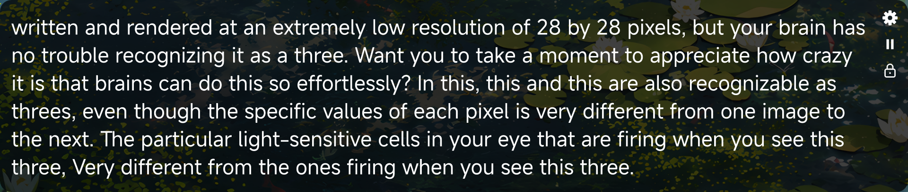

# 🎙️ Subtly

Live captions for system audio or your microphone, fully offline, on Wayland.

[](https://github.com/SimonShiki/subtly/releases)
[](LICENSE)
[](https://github.com/SimonShiki/subtly/actions/workflows/packages.yml)
[](https://wayland.freedesktop.org/)



Subtly is a lightweight software that transcribes system audio or microphone input, and displays live captions on a floating caption bar.

## ✨ Features

* **Fully offline** Subtly provides a bunch of caption models that work on-device.
* **Low-cost and speedy without GPU** Subtly is written in C++ and carefully selects and crafts models that work decently on CPU. For example, the default model "Moonshine Tiny Streaming" provides real-time transcription with ~0.4% CPU and ~300M RAM usage. (Intel(R) Core(TM) Ultra 7 255H)
* **Wayland-native** Subtly is purposefully built for the Wayland environment, using `wlr-layer-shell` and LayerShellQt to implement the floating caption bar.

## 🧠 Models

You can download models in Settings. Moonshine Tiny Streaming is the default and the best starting point.

| Model | Languages | Resource use | Accuracy | Notes |
| --- | --- | --- | --- | --- |
| **Moonshine Tiny Streaming** (default) | English, Japanese, Mandarin Chinese | Low | Good | Best balance of accuracy, speed, and cost |
| **Zipformer** | English, Chinese + English | Lowest | Lower than Moonshine | For machines where resources are tight |
| **Nemotron** | English, multilingual (3.5) | High | Best | Needs more CPU and RAM; experimental |

## 📦 Install

You can choose and download prebuilt packages on the [Release Page](https://github.com/SimonShiki/subtly/releases) for your distribution.

> [!WARNING]
> The Nemotron variant (`subtly-nemotron`) is experimental. It is not recommended for non-NVIDIA devices, since it consumes much more CPU and RAM than other models.

## 🛠️ Build from source

```bash
# Install dependencies
pacman -Sy --needed xmake ca-certificates curl git unzip patchelf qt6-base \
              qt6-declarative qt6-svg qt6-wayland layer-shell-qt pipewire # This can be different depending on your distro, just check `.github/workflows/packages.yml` for your distro's package list

# Build and run
xmake f -m release && xmake
xmake run subtly
```

If you are using Arch Linux, you can install `patchelf` and run `makepkg -si` in the repository checkout to install it system-wide.

## 🤝 Contributing

Issues and pull requests are welcome.

## 📄 License

Subtly is released under the [MIT License](LICENSE).
